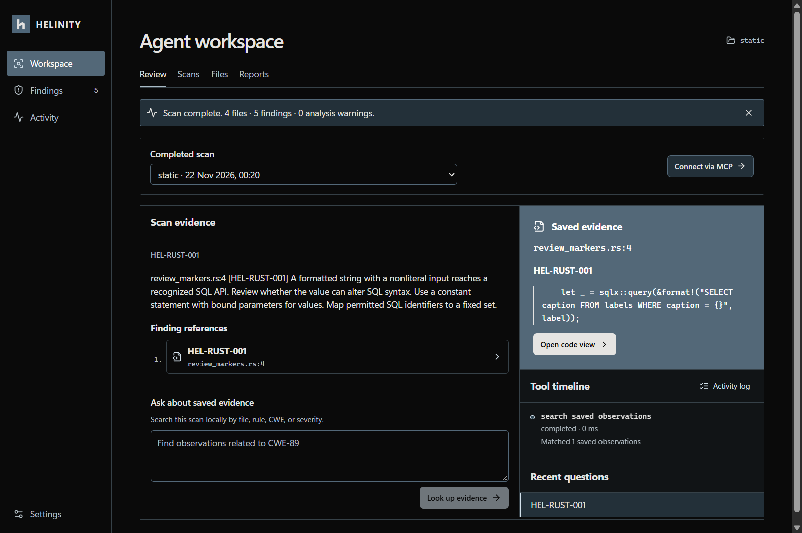
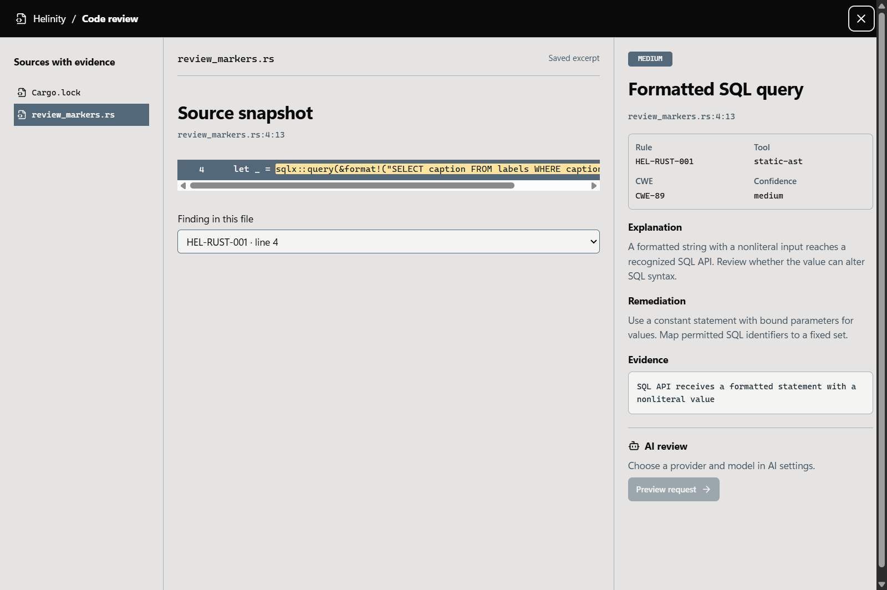
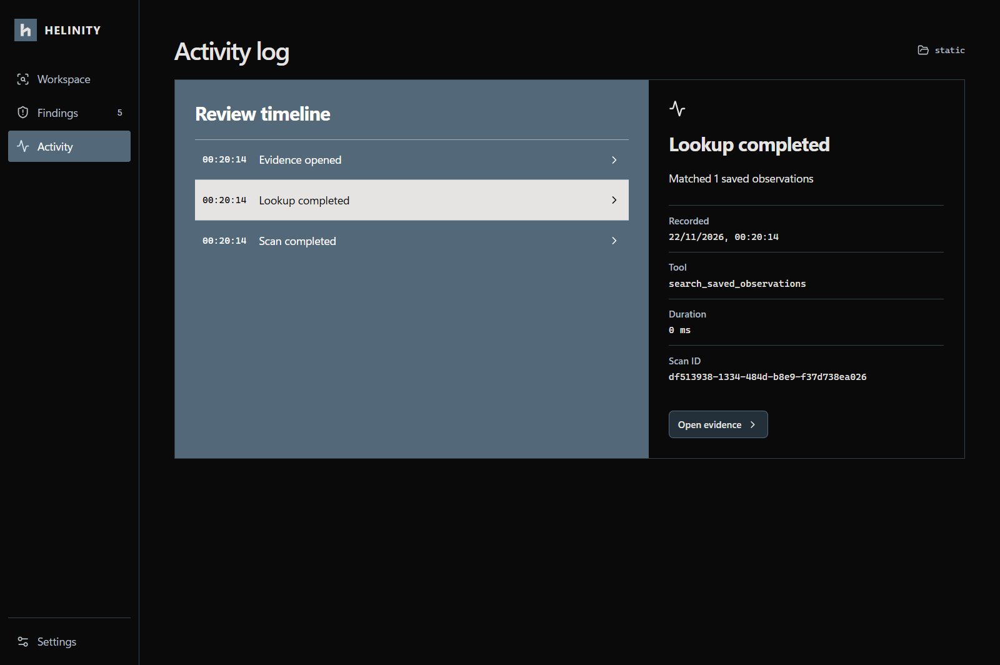

# Rust Security

**Copy this prompt into your coding assistant**

> Install Rust Security from https://github.com/Helincharm/rust-security. Follow INSTALL.md, connect it to my MCP client for the Rust project I choose, and verify the connection by scanning the included fixture and opening one finding at its source line. Tell me which client and project folder you configured.

Rust Security helps reviewers trace a potential security issue to the Rust expression or locked dependency that triggered it. The CLI, desktop app and Model Context Protocol (MCP) server use the same local scanner. A standard scan reads the selected project without building it or running its code. It requires no model or API key.



## What the scanner checks

| Result | What triggered it | What to review |
| --- | --- | --- |
| Source finding | A syntax rule matched Rust code, such as a formatted statement passed to a recognized SQL API. | Open the reported file and line. Check where the value comes from and how the receiving API interprets it. |
| Dependency advisory | A crate version in Cargo.lock matched an affected range in the bundled RustSec snapshot. | Check the advisory, enabled features and target platform before deciding whether the project is affected. |
| Analysis warning | The scanner could not fully inspect part of the input. | Review the affected file before drawing conclusions about coverage. Warnings have their own count. |

The source rules cover specific patterns. They do not resolve types or follow values across function boundaries. The dependency check uses 18 pinned advisory records. A scan with zero findings means the enabled checks found no matches in the inputs they could inspect. [Detection rules and coverage](TOOL_ADAPTERS.md)

## Guide: review your first scan

### 1. Scan the included example

Follow the [installation guide](INSTALL.md) to build the scanner and connect Codex or Claude Code. In the desktop app, select the repository's `fixtures/static` folder and choose **Run scan**. To run the same example from the repository root with `helinity` on your PATH:

```sh
helinity scan fixtures/static
```

The example covers four files. Expect **four source findings, one dependency finding and zero analysis warnings**. To see a clean result from the same fixture, run `helinity scan fixtures/static/controls.rs`.

### 2. Follow a finding to its source

Select **HEL-RUST-001** and choose **Open code view**. In the example, the saved excerpt points to `review_markers.rs:4:13`, where a formatted string reaches a SQL query. Read the highlighted expression alongside the rule explanation. The review question is whether a caller can influence SQL syntax through that value.



### 3. Revisit or share the review

Open **Activity** to see when the scan completed, which observations were looked up and which evidence was opened. Select an event to inspect its details. For a machine-readable report, use the scan ID returned by the CLI with `helinity report --format sarif --scan SCAN_ID`. JSON is also available.

<details>
<summary>View the activity log for this example</summary>



</details>

### Review from an MCP client

Once connected, ask your assistant: “Scan the configured project. List source findings, dependency advisories and analysis warnings separately. For the first source finding, show the rule, relative file path and line.” The connection is scoped to the directory you selected during setup. Source excerpts are opt-in.

[CLI commands and report formats](CLI_GUIDE.md) · [Architecture](ARCHITECTURE.md) · [Security model](SECURITY_MODEL.md)
